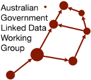

# AGLDWG PID Register - Data

This repository contains the source data for the [Australian Government Linked Data Working Group](https://www.linked.data.gov.au) (AGLDWG)'s Persistent Identifier (PID) register. The register maintains PIDs within the `linked.data.gov.au` namespace.

## The Register(s)

This Register has multiple sub-registers within it, for different classes of things:

* PIDs
  * `linked.data.gov.au/(dataset|def|org|pid)/`
  * persistent identifiers
* Organisations
  * `linked.data.gov.au/org/`
  * any organisation that submits PID requests to the AGLDWG
  * e.g. the Department of Finance, [`https://linked.data.gov.au/org/finance`](https://linked.data.gov.au/org/finance)* 

Within the PID register indicated above, there are several child registers containing specalised classes of PID:

* Datasets
  * `linked.data.gov.au/dataset/`
  * Linked Data datasets online
  * e.g. [`https://linked.data.gov.au/dataset/bdr`](`https://linked.data.gov.au/dataset/bdr`)
* Definitional Items
  * `linked.data.gov.au/def/`
  * Linked Data ontologies, vocabularies, profiles, etc.
  * e.g. the [ICSM](https://linked.data.gov.au/org/icsm)'s national _Address Model_, [`https://linked.data.gov.au/def/addr`](https://linked.data.gov.au/def/addr)
* Registered PIDs
  * `linked.data.gov.au/pid/`
  * persistent identifiers for the metadata of registered PIDs
  * for example, the PID for the PID [`https://linked.data.gov.au/dataset/bdr`]([`https://linked.data.gov.au/dataset/bdr`](`https://linked.data.gov.au/dataset/bdr`) - the PID used to identify [DCCEEW](https://linked.data.gov.au/org/dcceew)'s [Biodiversity Data Repository](https://bdr.gov.au/)'s main dataset - is `https://linked.data.gov.au/pid/dataset/bdr`.

## Creating PIDs

PIDs for PID Registrations and Organisations redirect to AGLDWG-managed metadata in the AGLDWG's PID Register Knwoledge Graph. PIDs for Datasets and Definitional Items resolve to whatever resources PID registrants nominate. 

The AGLDWG creates PIDs according to its [Guidelines](https://www.linked.data.gov.au/guidelines). PIDs, once approved, are automatically enabled through extraction of redirect information from this catalogue and automated deployment to the PID Proxy server at `linked.data.gov.au`.

Please refer to the -guidelines_ page linked to above for more details about who can and how to make PIDs.

## Redirect tests

Pull requests targeting `main` run the `Redirect tests` check in GitHub Actions. It checks out the PR's exact head commit,
builds Apache redirect configurations from that branch's local `resources/pids` files, and runs
`scripts/test_redirects.py` against those configurations in Docker. New commits to the PR rerun the check.

The workflow creates its `.conf` files under the runner's temporary directory and deletes them when the test step exits,
including on failure. It does not upload or cache the generated configurations, and rejects committed `.conf` files.

The `main` branch requires the `Redirect tests` check from GitHub Actions to pass before merging, including administrator
merges. The branch must also be up to date with `main` before merging. Keep this job name unchanged unless the required
check in the branch protection settings is updated too.

To build and test locally, start Docker and run:

```bash
task test-redirects
```

Both scripts default to the same configuration directory under the operating system's temporary directory. Set
`PID_TEST_CONF` to use a different directory for both scripts, or pass `--output` to the builder and set `PID_TEST_CONF`
to that path when testing. To use a fresh directory and remove it automatically after a local run:

```bash
redirect_temp=$(mktemp -d)
export PID_TEST_CONF="$redirect_temp/conf"
trap 'rm -rf "$redirect_temp"' EXIT
uv run --locked python scripts/build_redirects.py
uv run --locked pytest -v scripts/test_redirects.py
```

## Synchronising RDF after a merge

The `Synchronise RDF` workflow runs when a merge updates `main`. It can also be started from the Actions tab using
**Run workflow** with `main` selected. Runs are serialised, and each run checks out the latest `main` before calling
`bash scripts/sync.sh` with the locked project dependencies.

The script reads `resources/manifest.ttl` and updates newer remote records and adds new remote records. It does not pull
remote changes into the local files (`True False True False` for the four `kgm sync` options).

Before merging the workflow, open the repository's **Settings → Secrets and variables → Actions**, then use
**New repository secret** to create all three secrets:

| Secret | Value |
| --- | --- |
| `SPARQL_ENDPOINT` | The target SPARQL dataset endpoint previously used in `scripts/sync.sh` |
| `SPARQL_USERNAME` | The endpoint's authentication username |
| `SPARQL_PASSWORD` | The endpoint's authentication password |

Alternatively, run these commands and enter each value at the prompt; do not put the values in command arguments:

```bash
gh secret set SPARQL_ENDPOINT --repo AGLDWG/pid-register-data
gh secret set SPARQL_USERNAME --repo AGLDWG/pid-register-data
gh secret set SPARQL_PASSWORD --repo AGLDWG/pid-register-data
```

The workflow supplies these secrets as environment variables only to the sync step. `scripts/sync.sh` exits with an error if a
value is missing. No endpoint or credential values belong in repository files. For a local sync, supply the same three
environment variables before running `bash scripts/sync.sh`, or create a `.env` file in the repository root:

```bash
SPARQL_ENDPOINT='your-endpoint-url'
SPARQL_USERNAME='your-username'
SPARQL_PASSWORD='your-password'
```

The script loads `.env` only when one or more required values are missing or empty. Existing non-empty environment values
take precedence over file values. The file uses Bash assignment syntax; quote values containing spaces or special
characters. `.env` is ignored by Git and should remain local.

KGM validates the manifest and its resources before synchronising. Its validator lookup can contact the Semantic
Background service, so that service must be reachable as well as the target SPARQL endpoint. A validator lookup timeout
fails the workflow; it does not indicate a successful sync. Inspect the failed Actions run before retrying it.

## License

All the content of this repository is licensed with the [Creative Commons Attribution 4.0 International](https://creativecommons.org/licenses/by/4.0/) license with the following copyright notice:

&copy; Commonwealth of Australia (Australian Government Linked Data Working Group), 2026

## Contact

For all matters relating to this repository and the registry that it supports, please contact:

**Australian Government Linked Data Working Group**  
<linkeddatairi@ardc.edu.au>  
<https://www.linked.data.gov.au>
